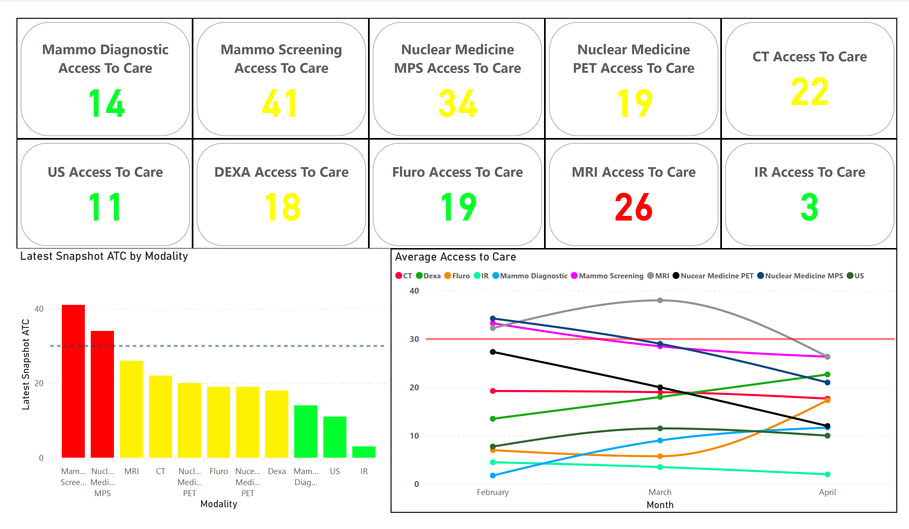

# Healthcare Operations and Workforce Analytics

**Author:** Cameron Batts

**Tools:** Power BI

## Problem
Bring together personnel coverage, qualifications, inbound/outbound staffing and access-to-care views for healthcare operations.

## Approach
Review the four-page Power BI export as a static dashboard artifact. Compare displayed personnel totals, inspect qualification and modality views, and identify definitions required to interpret the measures.

## Findings
The first page displays 85 personnel, 4 deployed, 10 inbound, 13 outbound and 46 personnel with an SEI code. The category chart shows counts of 68, 17, 9 and a small fourth category; the labeled 68 is 70.83%, implying a chart denominator of about 96 rather than 85. The department treemap labels sum to 96. These views require reconciliation before they can be treated as one workforce total. The access-to-care cards display values from 3 for IR to 41 for mammography screening; MRI is 26. Units and as-of dates are not stated in the export.

## Interpretation
Personnel, assignment records and qualifications may have different counting grains. Multiple SEI codes per person could explain why qualification slices exceed the distinct-person headline, but this cannot be confirmed without the data model. The access-to-care page also shows differing labels and category coverage between cards and charts, including duplicate or misspelled Nuclear Medicine/PET labels. These require a consistent modality mapping.

## Limitations
No PBIX/PBIT, source tables, DAX measures, relationships, refresh history or metric dictionary are included. Counts and snapshot scopes cannot be independently recomputed, and interactive filters are untested. Card colors and chart reference lines do not establish a validated service-level threshold. No improvement in staffing, throughput, patient access or financial outcomes has been measured in the supplied artifacts. The report is a historical portfolio export, not current operational status.

## Verification
Reviewed all four PDF pages and visually inspected the personnel and access-to-care pages. Checked the displayed arithmetic. Power BI was not opened or refreshed.

## Reproduce and extend
Open the included PDF or HTML report. Full verification requires the original Power BI report and an approved, anonymized or synthetic dataset, together with distinct-person definitions, snapshot dates, modality mappings and access-to-care units. The source data is not bundled.

## Files
- [Analysis report](Reports/powerbi_healthcare_operations.html)
- [Original export](Reports/FlightDashboard.pdf)
- [Live analysis](https://cameron-batts.github.io/powerbi_healthcare_operations.html)

